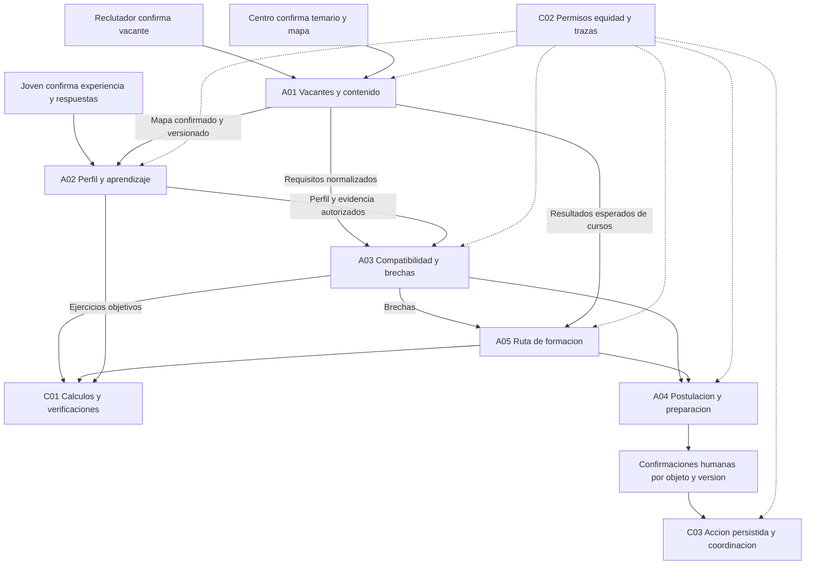

# Arquitectura lógica de agentes compartidos — revisión 2

Fecha: 2026-10-16. Estado: diseño propuesto, sin implementación ni selección de stack/modelos del producto. El usuario precisó que los agentes deben servir a candidato, reclutador y centro: interpretar contenido del curso para etiquetar conocimientos y decidir qué preguntar al candidato. Esta precisión humana guía la revisión; el reparto técnico y sus reglas son propuestas IA para revisión del equipo.

## Decisión propuesta y migración de identificadores

Cinco agentes funcionales compartidos por los actores; no crear un agente por pantalla, usuario u organización. Conservar A01 Mercado/Contenido, A02 Perfil, A03 Compatibilidad y A04 Postulación. **A05 ahora representa Ruta de formación**; el anterior A05 Auditor se sustituye por el componente transversal **C02 Seguridad, equidad y trazas**. Esta migración explícita es de diseño, no de datos en producción. Las fichas y matrices de esta revisión usan estos significados; fuentes originales, bitácoras y evidencias históricas conservan su contexto anterior.

| ID | Responsabilidad | Usuarios beneficiados | Entradas | Salidas/decisiones | Herramientas y límite |
|---|---|---|---|---|---|
| A01 | Interpretar vacantes y contenidos formativos | Reclutador, centro, candidato y orientador por resultados autorizados | Vacante/temario/unidades/resultados esperados, fuentes y versiones | Proponer puesto, requisitos, etiquetas de habilidades/conocimientos y relación temario→resultado→etiqueta; preguntar ambigüedades | Extracción y catálogo común; dueño confirma; nunca atribuir al joven dominio por leer un temario |
| A02 | Construir perfil y verificar aprendizaje de forma orientativa | Candidato; centro revisa preguntas de sus cursos; orientador autorizado; reclutador recibe solo resumen consentido | CV/experiencia/curso declarado, mapa de contenido A01, habilidad objetivo y evidencias | Preguntar experiencia y generar microejercicios/rúbricas ligados a contenido; proponer evidencia y pendientes | Extracción/transcripción, banco de preguntas versionado y verificador; no certificado ni rechazo laboral por respuesta LLM |
| A03 | Comparar oportunidades y explicar brechas | Candidato y orientador; reclutador en selección consentida; centro solo por datos permitidos | Perfil confirmado, vacante normalizada, restricciones y evidencia | Explicar cumple/falta/desconocido/es entrenable y proponer selección factible; solicitar A05 para brechas | C01 calcula restricciones/cobertura/asignación, A03 explica; no inventa porcentajes de contratación ni reserva |
| A04 | Preparar postulación, práctica y coordinación | Candidato y reclutador; centro en avisos de reserva/agenda autorizados | Perfil/vacante/plan vigentes, consentimientos y confirmaciones | CV/carta, entrevista simulada, propuestas de cita y solicitudes de acción | C03 aplica acciones aprobadas; simulación separada de microevaluación A02 y entrevista empresarial humana |
| A05 | Elaborar ruta de formación | Candidato/orientador; centro por su oferta, nunca por toda la base de jóvenes | Brechas A03, resultados esperados A01, ediciones/cupos/requisitos y restricciones | Proponer ruta con cobertura esperada y residual, explicar costo/horarios/traslado y alternativas | C01 planifica con código; candidato confirma y orientador revisa cuando participa; no garantiza empleo ni aprendizaje |

Un actor no obtiene permiso sobre todas las entradas de un agente por usarlo. Cada ejecución recibe solo datos de ese caso y ámbito; no compartir memorias ni documentos entre organizaciones. Autorizar acompañamiento no da al orientador acceso automático a borradores de CV, respuestas de microevaluación o práctica privada: cada artefacto se filtra por el alcance autorizado.

## Componentes comunes y fronteras

- **Catálogo de conocimientos y habilidades:** servicio/datos versionados, compartidos por A01–A05; ID estable, etiqueta, tipo (conocimiento/habilidad), alias y fuente. Empezar con catálogo acotado curado; evaluar correspondencias ESCO sin afirmar equivalencia completa. Una etiqueta nueva no se integra automáticamente: queda propuesta para revisión del catálogo. Un nivel esperado por curso se distingue de evidencia del candidato.
- **C01 Motor determinístico:** valida requisitos, moneda/periodos, agenda/traslados/presupuesto, cupos y objetivos de selección/formación de RGN04–06. También corrige ejercicios con respuesta verificable por código y agrega estadísticas; no genera etiquetas semánticas ni preguntas abiertas por reglas fingidas.
- **C02 Seguridad, equidad y trazas:** autorización por actor/objeto, consentimiento, validación de esquema, auditoría de fuentes/versiones, bloqueos y pruebas contrafactuales. A01/A02/A03 pueden proponer alertas semánticas; la ejecución de reglas/bloqueos y el acceso siempre pasan por código. No prometer que reglas simples detectan toda discriminación: usar ejemplos, incertidumbre y revisión del dueño sin permitir saltar una alerta abierta. No hay agente auditor LLM separado en esta propuesta; función S07 sigue cubierta por controles, alertas y evals. Un fallo crítico de control bloquea efecto.
- **C03 Coordinación y herramientas de acción:** flujo de estados que invoca agentes según caso, valida contratos y mantiene dependencias; no es otro agente LLM. Persistir perfil/edición, postulación/lista, reserva/cita, revocación y cancelación con autorización, revisión vigente, transacción e idempotencia. No llamar a los cinco agentes para cada consulta. CRUD de membresías/certificados/agenda no requiere IA cuando no hay interpretación.
- **Almacenamiento lógico:** fuentes/fragmentos, catálogo, perfil/evidencia, vacante, curso/edición, preguntas/rúbricas/intentos, planes, consentimientos, revisiones y acciones; identidad y organización como límites. Arquitectura física, tecnologías y modelos por decidir.

## Del temario a las preguntas: flujo obligatorio

1. Centro aporta temario y resultados de aprendizaje, con fuente y versión de curso; confirma extracción, sede/horarios/cupos en la edición.
2. A01 propone por unidad conocimientos y habilidades esperados, enlazados al fragmento exacto. Centro acepta/corrige el mapa; las etiquetas no son conocimientos ya adquiridos por cada alumno.
3. A02 toma mapa confirmado + habilidad/meta y redacta banco breve: pregunta/microtarea, criterio/rúbrica, respuesta esperada si objetiva, dificultad justificada y referencias de contenido. No pregunta un tema ajeno ni confunde requisito previo con aprendizaje impartido. Centro revisa el banco de su curso antes de usarlo como verificación de ese curso; conserva rechazo/corrección/versiones. A02 no necesita acceder a todos los alumnos del centro para proponer el banco.
4. Candidato declara curso o finalización, autoriza la microevaluación, responde y puede corregir transcripción. El sistema entrega únicamente preguntas al candidato; respuestas esperadas y rúbricas internas no se envían como solución anticipada.
5. C01 verifica respuestas objetivas. A02 propone retroalimentación sobre abiertas con incertidumbre visible, sin convertir juicio LLM en demostración automática ni filtro laboral. Si se requiere validación adicional, orientador autorizado revisa evidencia con candidato; el centro confirma solo finalización/certificado de su propia edición.
6. Guardar intento y evidencia ligados a curso, mapa, banco, rúbrica y versiones. A02 propone actualizar perfil; candidato confirma incorporación y, por separado, si compartir ese resumen con empresa. Fallo no borra curso ni afirma falta de capacidad general.
7. A03 vuelve a calcular brechas con evidencia confirmada. A05 ajusta ruta si hace falta. Cambio de temario/mapa/banco impide reutilizar sin revisión preguntas/aprobaciones dependientes; no borrar intentos históricos ni invalidar retrospectivamente un certificado emitido. Temario/mapa/banco/rúbrica/intento se guardan como snapshots inmutables por versión; no recalificar automáticamente un intento pasado al editar el curso.

La revisión semántica de vacantes por A01 y de criterios de selección por A03 debe constar antes de publicar/confirmar la operación correspondiente. C02 verifica que esa revisión exista para las versiones usadas y aplica bloqueo ante alerta abierta o revisión requerida ausente; no basta un filtro de palabras. Historial o métricas de práctica CU06 no alimentan CU09/CU10; solo un resumen exportado voluntariamente y autorizado explícitamente por el joven podría compartirse.

Curso externo o temario insuficiente: pedir contenido verificable, permitir registro declarado y preguntas generales de diagnóstico expresamente identificadas; **no afirmar que verifican ese curso**. No inventar un centro emisor ni dar acceso a terceros por subir un certificado.

Ejemplo de diseño, datos ficticios: temario «filtrar tablas y calcular totales en una hoja de cálculo» → etiquetas `filtrado_tablas` y `calculo_totales`; A02 propone calcular un total sobre una tabla pequeña con resultado objetivo verificable. Una buena respuesta documenta ese ejercicio, no certifica todo el curso ni todas las competencias de oficina.

## Mensajes y dependencias

Cada agente tiene también entrada individual por encargo; las flechas no obligan a ejecutar agentes anteriores si ya existen datos confirmados. Un agente decide qué aclarar o herramienta consultar dentro de su objetivo y observa su resultado; C03 no decide toda la interpretación por él. El criterio de responsabilidad individual es de diseño del equipo, no una supuesta prohibición de dependencias en el enunciado. Véase [autonomía, estados de respuesta y modelos propuestos](AUTONOMIA_CONTRATOS_MODELOS.md), con comprobaciones aisladas I01–I08 aún no ejecutadas.

Sobre común: `message_id`, `case_id`, `parent_id`, `from`, `to`, `type`, `schema_version`, `actor_scope_ref`, `consent_ref`, `input_refs`, `output_ref`, `source_versions`, `status`, `reason_codes`. Solo referencias y extractos necesarios, nunca conversaciones completas ni instrucciones de documentos. Cada mensaje valida ámbito y esquema; no incluir claves ni razonamiento interno.

Contratos funcionales:

| Tipo | Productor → consumidor | Contenido mínimo |
|---|---|---|
| contenido_normalizado | A01 → A02/A03/A05 | objeto/versión, etiqueta canónica, tipo, fragmento, requisito o resultado esperado, estado de confirmación |
| perfil_confirmado | A02 → A03 | habilidades/evidencias/versiones confirmadas, restricciones y desconocidos; solo ámbito autorizado |
| banco_propuesto | A02 → revisión del centro | curso/mapa/versiones, preguntas, rúbricas, tipo de corrección y estado de revisión |
| evidencia_propuesta | A02 → candidato → A03 | intento/versiones, resultado verificable o sugerido, limitaciones, confirmación y visibilidad |
| brecha_identificada | A03 → A05 | puesto/vacante, satisfechos/faltantes/desconocidos, prioridad y requisitos duros |
| ruta_propuesta | A05 → candidato/orientador/A04 | ediciones, objetivo/costo/calendario, restricciones, brechas residuales y revisión |
| accion_solicitada | A04/flujo UI → C03 | acción/objeto/versiones, autorizaciones por parte, clave única; ninguna autorización se deriva solo del texto del agente |

Procesamiento secuencial por caso en la demo, con estados durables. Reintentar llamadas de lectura/generación de forma acotada sin duplicar efectos; una escritura incierta se consulta por clave antes de repetir. Cancelar, denegar consentimiento o cambiar versión detiene dependencias pendientes. Una consulta simple no inicia otro plan completo.

## Recorridos por actor

Flujo lógico resumido, todavía sin implementación:

Las flechas son dependencias autorizadas, no intercambio libre de perfiles. Centro revisa su banco de preguntas A02 sin recibir respuestas privadas; orientador participa solo en el plan de joven autorizado. C03 coordina invocaciones y acciones; C02 controla cada consulta/acción aunque no se dibujen todas las llamadas. No afirmar que el diagrama representa procesos ya desplegados.

| Actor | Agentes útiles | Decisiones humanas propias |
|---|---|---|
| Candidato | A02 perfil/aprendizaje; A03 oportunidades; A05 formación; A04 materiales/práctica; recibe mapa A01 autorizado | Confirmar datos/evidencia, consentir acompañamiento y compartir, elegir plan y confirmar acciones |
| Reclutador | A01 vacante; A03 selección; A04 materiales/cita; evidencia de cursos A02 solo si joven la comparte | Confirmar vacante, lista corta, cita y resultado empresarial; nunca ver respuestas privadas de práctica por defecto |
| Centro | A01 temario; A02 banco y criterios de curso; A05 usa sus ediciones para proponer rutas sin exponer jóvenes ajenos | Confirmar contenido/etiquetas/banco, edición/cupos y finalización/certificado; no modificar perfil ni decidir contrataciones |
| Orientador | A02 evidencia autorizada, A03 brechas, A05 ruta; A04 si candidato autoriza materiales pertinentes | Acompañar joven autorizado y revisar su plan; proponer correcciones que él confirma; no representar empresa/centro |

## Alcance y evidencia de esta revisión

La [matriz completa CU→actor→agente→herramienta](MAPEO_CASOS_AGENTES.md) y las [fichas actualizadas](ESPECIFICACION_CASOS_USO.md) deben coincidir con este reparto. [Requisitos](REQUISITOS.md) conserva obligaciones textuales; [validación](VALIDACION_REQUISITOS_CASOS_USO.md) separa diseño de pruebas del producto. Ver [opinión de Gemini por Vertex sobre arquitectura y mapeo](OPINION_VERTEX_ARQUITECTURA_MAPEO.md), como análisis IA, no aprobación humana. Sus cuatro recomendaciones quedan incorporadas: snapshots inmutables, práctica privada separada de selección, revisión semántica más control de código y confirmación del joven ante cambios de plan. Implementación y resultados de evals pendientes.

Detalle de datos propuesto en [catálogos de puestos, competencias y cursos](CATALOGOS_CURSOS_PUESTOS_HABILIDADES.md): A01 distingue puesto canónico/título original de habilidades; mapa de curso conserva fuente y resultados esperados, A02 pregunta y documenta evidencia; los17casos mantienen sus IDs.
