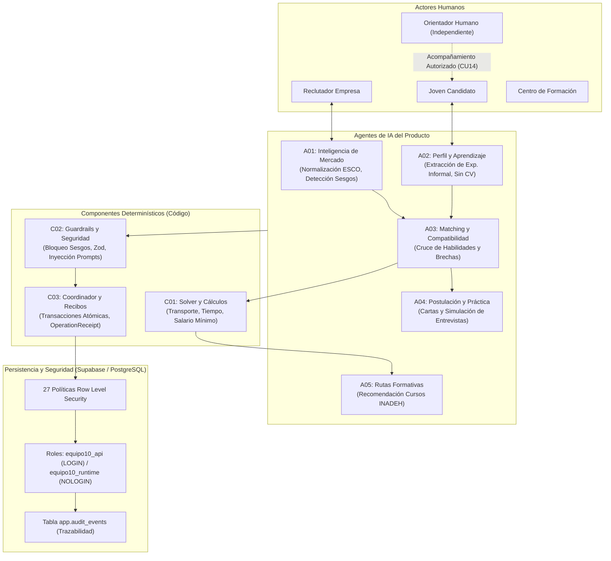

# Documento de Metodología y Funcionamiento del Sistema

**Competencia:** Hackathon FISC AI Agents 2026 — CONTECS 2026  
**Reto Oficial:** Reto 3 — Empleabilidad Juvenil  
**Equipo:** Mainor Villarreal (@tlegend7) y Giovanny Arpaia (@giovaar)  
**Entregable Oficial:** D07 (§6 p. 7; rúbrica §7 p. 8)  
**Estado:** Etapa D1 desplegada y verificada; especificaciones vigentes para D2–D9.

---

## 1. Introducción y Enfoque del Reto

El desempleo juvenil en Panamá supera con creces el promedio nacional y alimenta la informalidad laboral. La problemática central es una desconexión tripartita caracterizada por asimetría y dispersión de información:
- **Jóvenes:** Carecen con frecuencia de un currículum tradicional formal; poseen experiencia informal valiosa pero no estructurada (apoyo en microempresas familiares, actividades comunitarias), y enfrentan restricciones críticas de movilidad urbana (rutas y tiempos de MiBus / Metro de Panamá), presupuesto y disponibilidad horaria.
- **Empresas:** Reciben volúmenes masivos de postulaciones desalineadas y publican ofertas con requisitos vagos o potencialmente discriminatorios (sesgos por edad, género o zona de residencia).
- **Centros de Formación (INADEH y afines):** Ofrecen programas técnicos con cupos y cronogramas fijos que frecuentemente no coinciden en tiempo y lugar con las brechas reales del mercado laboral.

Para resolver esto sin recurrir a un simple chatbot conversacional (cumpliendo la **Regla de Oro** de la competencia), diseñamos un **mercado agéntico de tres lados** con supervisión humana, soportado por un sistema híbrido donde la Inteligencia Artificial percibe, interpreta y sugiere, mientras componentes determinísticos de código ejecutan cálculos, verificaciones de viabilidad y persistencia de datos auditables.

---

## 2. Arquitectura Agéntica e Híbrida del Sistema

La solución integra **5 agentes de producto especializados** y **3 controladores determinísticos en código**, asegurando roles definidos, trazabilidad de decisiones y control humano:

### 2.1 Agentes de IA del Producto
1. **A01 — Inteligencia de Mercado:** Procesa ofertas y temarios de cursos; normaliza requerimientos contra la taxonomía de habilidades (ESCO / O*NET); audita términos discriminatorios.
2. **A02 — Perfil y Aprendizaje:** Entrevista conversacionalmente al joven para modelar su perfil, capturando experiencia informal, intereses y competencias observables sin exigir un CV en formato PDF.
3. **A03 — Matching y Compatibilidad:** Evalúa el ajuste candidato-vacante. Identifica brechas técnicas y entrega insumos al solver de movilidad geográfica y económica.
4. **A04 — Postulación y Preparación:** Genera borradores de postulación consentida y conduce simulaciones de entrevistas con retroalimentación cualitativa.
5. **A05 — Rutas de Formación:** Genera planes formativos optimizados para cerrar brechas específicas en coordinación con la oferta de centros de capacitación.

### 2.2 Componentes Determinísticos de Código (No LLM)
- **C01 (Cálculos y Solver):** Algoritmos determinísticos que calculan tiempos de viaje en transporte público metropolitano (red MiBus y Metro), costos de pasaje, compatibilidad de turnos y verificación de salario mínimo legal. Ninguna estimación numérica o de viabilidad física es delegada al modelo de lenguaje.
- **C02 (Guardrails y Equidad):** Filtros sintácticos y semánticos contra *prompt injection*, evasión de restricciones y pruebas contrafactuales de sesgo (verificando que la evaluación no varíe por nombre, género o corregimiento).
- **C03 (Acción y Recibos):** Manejo de transacciones atómicas con emisión de comprobantes inmutables (`OperationReceipt`). Toda reserva de cupo o postulación requiere confirmación humana expresa.

### 2.3 Humano en el Ciclo (Human-in-the-Loop)
- **Confirmación del Candidato:** El joven aprueba explícitamente su perfil antes de que sea visible y autoriza de forma individual cada postulación laboral.
- **Orientador Humano Independiente (CU14):** Cuenta con vista de acompañamiento autorizada para supervisar a jóvenes vulnerables, corregir recomendaciones y garantizar un proceso libre de sesgos.
- **Empresas y Centros:** Mantienen control total sobre la publicación de vacantes y cupos disponibles, recibiendo únicamente postulaciones consentidas.

---

## 3. Despliegue e Infraestructura de Datos

El sistema se apoya en una arquitectura moderna, desacoplada y orientada a microservicios sobre la nube de **Supabase** y ejecución local de alto rendimiento:

### 3.1 Base de Datos PostgreSQL 17 y Seguridad Multi-Tenant
- **Catálogo de Datos:** 27 tablas relacionales y 18 enums estructurados bajo el esquema aislado `app`, garantizando segregación frente al esquema `public` o esquemas internos de Supabase (`auth`, `storage`).
- **Segregación de Roles PostgreSQL:**
  - `equipo10_api`: Rol de conexión (`LOGIN`, `NOINHERIT`) configurado sin privilegios de bypass (`NOBYPASSRLS`).
  - `equipo10_runtime`: Rol transaccional de datos (`NOLOGIN`, `NOINHERIT`). Toda transacción API establece el contexto del actor mediante la variable GUC `app.current_actor_id` (`SET LOCAL ROLE equipo10_runtime`).
- **Políticas de Seguridad a Nivel de Fila (RLS):** 27 políticas RLS activas que impiden fugas de datos entre candidatos, empresas y organizaciones.
- **Conectividad TLS Estricta:** La base de datos requiere TLS v1.3 verificado contra el certificado CA público de Supabase (`certs/supabase-prod-ca-2021.crt`) con `rejectUnauthorized: true`.

### 3.2 Automatización de Despliegues Idempotentes
El aprovisionamiento y verificación de la base de datos se realiza mediante `scripts/deploy-d1.mjs`:
- `--check`: Valida credenciales, conectividad TLS y ausencia de privilegios de superusuario en el rol de runtime.
- `--apply`: Aplica migraciones DDL de Prisma (`prisma/migrations/`) y reglas de seguridad (`prisma/runtime-access.sql`).
- `--verify`: Ejecuta pruebas transaccionales con rollback automático (`ROLLBACK`), verificando que los permisos funcionen sin dejar registros residuales ni modificar datos de producción.

---

## 4. Stack Técnico y Gobernanza de Código

La selección tecnológica (decisión formal ST01) garantiza velocidad de compilación, seguridad de tipos de extremo a extremo y ligereza:

| Capa | Tecnología | Justificación y Rol en la Solución |
|---|---|---|
| **Runtime & Package Manager** | Bun 1.3.14 | Ejecución rápida de scripts, gestor de dependencias ultrarrápido y test runner nativo (`bun:test`). |
| **Backend API** | Hono | Framework HTTP minimalista sobre estándares web, modularizado verticalmente por dominios (`identity`, `profile`). |
| **Contratos de Datos** | Zod | Validación estricta de esquemas en tiempo de compilación y ejecución compartida entre cliente y servidor ([packages/contracts](file:///c:/Users/sebas/OneDrive%20-%20Universidad%20Tecnol%C3%B3gica%20de%20Panam%C3%A1/Documentos/Universidad/Hackaton/magi/solucion/equipo-10/packages/contracts)). |
| **ORM y Migraciones** | Prisma 7 (`@prisma/adapter-pg`) | Tipado exhaustivo de consultas y control de migraciones versionadas con motor reproducible. |
| **Frontend Web** | React 19 + Vite 8 | Interfaz reactiva optimizada con soporte completo de TypeScript. |
| **Diseño y Estilos** | CSS Modules + Tokens Figma v2 | Paleta terracota/marfil/carbón/oliva con compatibilidad nativa para modo claro y oscuro sin dependencias pesadas. |
| **Autenticación** | Supabase Auth (JWT) | Validación de tokens mediante `supabase.auth.getUser(token)`, disociando credenciales de la lógica interna de negocio. |

---

## 5. Metodología de Desarrollo y Gobernanza Ética

1. **Distinción entre Entorno de Desarrollo y Producto:**  
   Herramientas de orquestación y asistencia al desarrollo utilizadas por el equipo humano (como el entorno multi-modelo MAGI, scripts auxiliares de prueba y OpenCode) operan estrictamente en el plano de desarrollo y están excluidas de la entrega final del producto. El repositorio contiene exclusivamente el software del reto.
2. **Cero Secretos y Privacidad de Datos:**  
   Ninguna clave privada, token de servicio ni dato personal real se almacena en el control de versiones. Se utiliza `.env.example` como contrato público y `.gitignore` riguroso.
3. **Trazabilidad en Bitácora de IA:**  
   Cada intervención de modelos de lenguaje (Vertex AI Gemini 3.8 Flash, GPT-6 Sol medium, Codex) está registrada cronológicamente en [docs/BITACORA_IA.csv](file:///c:/Users/sebas/OneDrive%20-%20Universidad%20Tecnol%C3%B3gica%20de%20Panam%C3%A1/Documentos/Universidad/Hackaton/magi/solucion/equipo-10/docs/BITACORA_IA.csv), detallando el modelo, aporte exacto, archivos impactados y validación humana por parte de Mainor Villarreal y Giovanny Arpaia.

---

## 6. Manejo de Errores, Límites y Recuperación de Fallos

### 6.1 Resiliencia y Manejo de Entradas Inesperadas
- **Entradas Maliciosas y Fuera de Dominio:** El componente C02 intercepta intentos de inyección o consultas ajenas a la intermediación laboral, respondiendo con códigos de error estructurados (`INVALID_INPUT`, `OUT_OF_SCOPE`) sin invocar agentes de inferencia costosos.
- **Detección de Sesgo en Vacantes:** Si un reclutador introduce una vacante con términos discriminatorios (ej. restricciones de edad no fundamentadas o exigencias de apariencia física), A01 marca la oferta como no conforme y el sistema bloquea su publicación hasta revisión humana.

### 6.2 Recuperación ante Fallos Técnicos
- **Desconexión o Latencia de Base de Datos:** La API implementa verificación de salud en `/health` y reintentos automáticos en el pool de conexiones de Supabase.
- **Rollback Transaccional:** Todas las operaciones compuestas (creación de perfil + evidencias + enlaces) se ejecutan dentro de bloques transaccionales atómicos; cualquier fallo aborta la operación completa impidiendo inconsistencias parciales.
- **Aislamiento de Cuentas:** Si un usuario intenta acceder a recursos de otra organización o candidato sin autorización, las políticas RLS de PostgreSQL devuelven conjuntos vacíos o excepciones de acceso (`PERMISSION_DENIED`), protegiendo la privacidad de forma nativa a nivel de motor de datos.

### 6.3 Trazabilidad y Auditoría
Cada acción relevante genera un registro en la tabla `app.audit_events`, almacenando el identificador del actor, la acción ejecutada, la marca temporal y el resultado, asegurando auditabilidad completa para los evaluadores.
